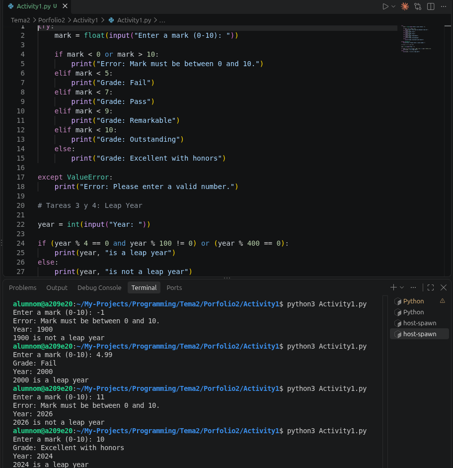
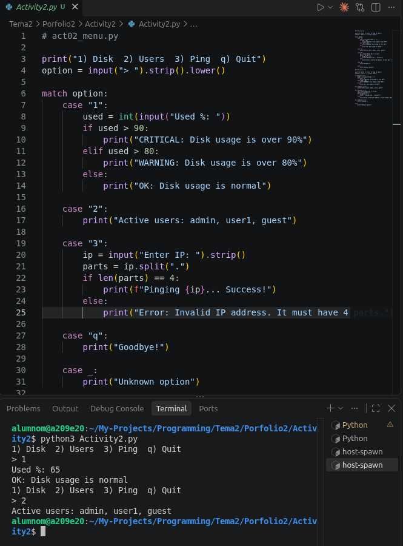
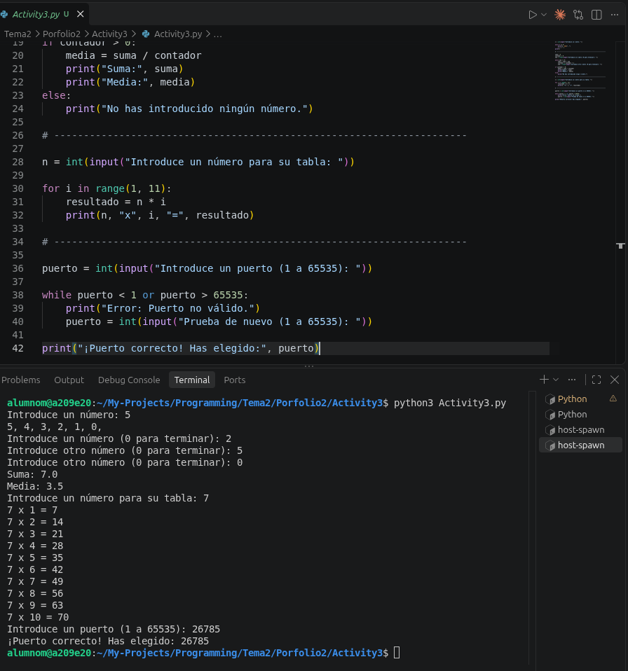
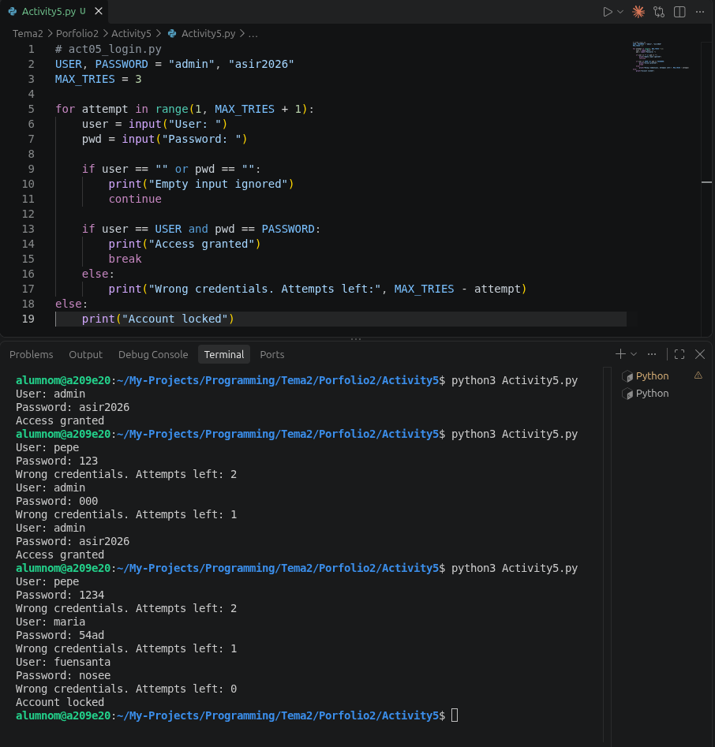

# Portfolio 2 - Programación en Python

Este repositorio contiene los ejercicios, prácticas y evidencias de ejecución correspondientes al **Portfolio 2** de la asignatura de **Programación**, desarrollados por **Máximo Sánchez Fernández**.

El objetivo principal de esta unidad es dominar las estructuras de control de flujo en Python: selección condicional (`if-elif-else`), coincidencia de patrones (`match-case`), iteraciones y bucles (`while`, `for`), validación de entradas de usuario y prevención de errores en tiempo de ejecución.

## 📁 Estructura del Repositorio

El proyecto está organizado en directorios independientes por actividad, incluyendo los scripts en Python y sus respectivas capturas de ejecución:

| Directorio | Script | Evidencia | Conceptos clave |
| :--- | :--- | :--- | :--- |
| `Activity1/` | `Activity1.py` | `Activity1.png` | `if-elif-else`, manejo de excepciones (`try-except`), operadores lógicos (`and`, `or`, `%`) |
| `Activity2/` | `Activity2.py` | `Activity2.png` | `match-case` (Python 3.10+), equivalencia con `if-elif-else`, manipulación de cadenas (`split`) |
| `Activity3/` | `Activity3.py` | `Activity3.png` | `while`, `for`, valor centinela (`sentinel`), prevención de división por cero |
| `Activity4/` | `Activity4.py` | — | Bucles anidados (`for`), formateo alineado con `f-strings`, patrones geométricos |
| `Activity5/` | `Activity5.py` | `Activity5.png` | Control de flujo avanzado (`break`, `continue`, `while-else`), validación de credenciales |
| `Anexo/` | `Anexo.py` | — | Estructura condicional alternativa, evaluadores lógicos compuestos (`or`) |

## 📝 Detalle de las Actividades

### 🔹 Actividad 1: Selección y Calificaciones (`Activity1/Activity1.py`)

Esta actividad se enfoca en la toma de decisiones basada en condicionales y el manejo seguro de entradas de usuario:

1. **Calculadora de Calificaciones (*Mark Calculator*):**
   * Recibe una nota numérica entre `0` y `10` y la clasifica en su escala correspondiente: *Fail*, *Pass*, *Remarkable*, *Outstanding* o *Excellent with honors*.
   * Incluye bloques `try-except` para capturar errores de tipo `ValueError` si el usuario introduce texto no numérico.
2. **Comprobador de Año Bisiesto (*Leap Year*):**
   * Determina si un año introducido es bisiesto evaluando la condición lógica: `(year % 4 == 0 and year % 100 != 0) or (year % 400 == 0)`.



### 🔹 Actividad 2: Menú de Consola e Inspección de Red (`Activity2/Activity2.py`)

Implementación de una interfaz de línea de comandos (CLI) para tareas básicas de administración de sistemas mediante dos enfoques de sintaxis:

1. **Sintaxis `match-case`:** Coincidencia de patrones moderna en Python.
2. **Sintaxis `if-elif-else`:** Alternativa condicional tradicional.

**Funcionalidades:**
* **Opción 1 (Disk):** Comprueba el porcentaje de uso del disco y lanza alertas (`CRITICAL` si >90%, `WARNING` si >80%, u `OK`).
* **Opción 2 (Users):** Muestra los usuarios activos en el sistema.
* **Opción 3 (Ping):** Valida que una dirección IP contenga exactamente 4 octetos separados por puntos (`len(ip.split('.')) == 4`).
* **Opción `q` (Quit):** Finaliza la ejecución de forma limpia.



### 🔹 Actividad 3: Bucles, Sumas y Tablas (`Activity3/Activity3.py`)

Profundización en ciclos iterativos y validación continua de datos:

1. **Cuenta atrás descendente (`while`):** Imprime valores desde $n$ hasta $0$ separados por comas.
2. **Suma y media interactiva con valor centinela (`while`):** Acumula números hasta recibir el valor centinela `0`. Controla la prevención de la división por cero (`ZeroDivisionError`) si no se introducen números válidos.
3. **Tabla de multiplicar (`for`):** Genera la tabla del 1 al 10 para un número dado mediante `range(1, 11)`.
4. **Validación de puerto de red (`while`):** Pide repetidamente un puerto hasta que el usuario introduzca un valor válido en el rango de `1` a `65535`.



### 🔹 Actividad 4: Patrones con Bucles Anidados (`Activity4/Activity4.py`)

Uso de ciclos `for` anidados para generar figuras geométricas y tablas de datos en consola:

1. **Triángulo rectángulo de asteriscos:** Lee una altura $n$ e imprime filas crecientes de asteriscos desde $1$ hasta $n$.
2. **Triángulo invertido:** Dibuja la misma figura en orden descendente desde $n$ hasta $1$.
3. **Tabla de multiplicar completa (1–10):** Genera una cuadrícula de $10 \times 10$ utilizando formato de ancho fijo mediante `f-strings` (`f"{i * j:4}"`) para mantener las columnas perfectamente alineadas.
4. **Ampliación (Cuadrado hueco):** Dibuja un cuadrado de lado $n$ imprimiendo asteriscos únicamente en los bordes (`i == 0`, `i == n - 1`, `j == 0`, `j == n - 1`) y espacios en el interior.

> **💡 Reflexión:** *¿Cuántas veces se ejecuta el `print()` interno para altura $n$?*
> En el triángulo rectángulo (y en el invertido), el bucle interno imprime $1$ asterisco en la primera fila, $2$ en la segunda, $3$ en la tercera, y así sucesivamente hasta $n$. Esto corresponde a la suma de una progresión aritmética (número triangular), por lo que el `print()` interno se ejecuta exactamente:
> $$\sum_{i=1}^{n} i = \frac{n(n + 1)}{2} \text{ veces}$$

### 🔹 Actividad 5: Control de Acceso y Autenticación (`Activity5/Activity5.py`)

Simulación de un sistema de inicio de sesión con límite de intentos mediante bucles controlados:

* **Límite de intentos (`while`):** Permite un máximo de 3 intentos fallidos (`MAX_TRIES = 3`) antes de bloquear el acceso.
* **Ignorar entradas vacías (`continue`):** Si el usuario deja el campo de usuario o contraseña en blanco, se muestra un aviso y se salta a la siguiente iteración sin consumir intentos.
* **Acceso concedido (`break`):** Si las credenciales coinciden con las constantes definidas (`admin` / `asir2026`), concede el acceso e interrumpe el bucle inmediatamente.
* **Bloqueo de cuenta (`while-else`):** Si el bucle agota todos los intentos sin que se ejecute el `break`, entra en el bloque `else` y muestra el mensaje de cuenta bloqueada (`Account locked`).



### 🔹 Anexo: Menú de Control Simplificado (`Anexo/Anexo.py`)

Un script complementario que demuestra el uso de un menú condicional compacto con múltiples disparadores por opción:

* **Selección de opciones:** Maneja comandos básicos (`1` para disco, `2` para usuarios, `q` para salir).
* **Alias condicionales:** Permite ejecutar la acción de reinicio de servicio tanto con el número `"3"` como con la letra `"r"` mediante la condición `elif option == "3" or option == "r":`.
* **Manejo de opciones desconocidas:** Captura cualquier entrada no válida a través de la cláusula final `else`.

## 🚀 Requisitos y Ejecución

### Requisitos previos

* **Python 3.10** o superior (necesario para el uso de `match-case`).

### Cómo ejecutar los scripts

Abre la terminal en la carpeta raíz `Porfolio2` y ejecuta el script deseado indicando su subcarpeta:

```bash
# Ejecutar Actividad 1
python3 Activity1/Activity1.py

# Ejecutar Actividad 2
python3 Activity2/Activity2.py

# Ejecutar Actividad 3
python3 Activity3/Activity3.py

# Ejecutar Actividad 4
python3 Activity4/Activity4.py

# Ejecutar Actividad 5
python3 Activity5/Activity5.py

# Ejecutar Anexo
python3 Anexo/Anexo.py
```

> **💡 Nota de entorno (VS Code en Linux):** Si ejecutas los scripts mediante el botón de reproducción (▶) y la terminal muestra el error `bash: /usr/bin/python: No existe el archivo o el directorio`, abre la paleta de comandos (`Ctrl + Shift + P`), busca `Python: Select Interpreter` y selecciona el ejecutable `/usr/bin/python3`.